

# كهف

**تطبيق إسلامي يهدف إلى تقديم تجربة مستخدم مريحة لقراءة واستماع القرآن الكريم، وتفسير الآيات، وقراءة الأذكار، ومعرفة مواقيت الصلاة.**

 

<a href="README-en.md">English</a>
&nbsp;-&nbsp;
العربية

 

 

  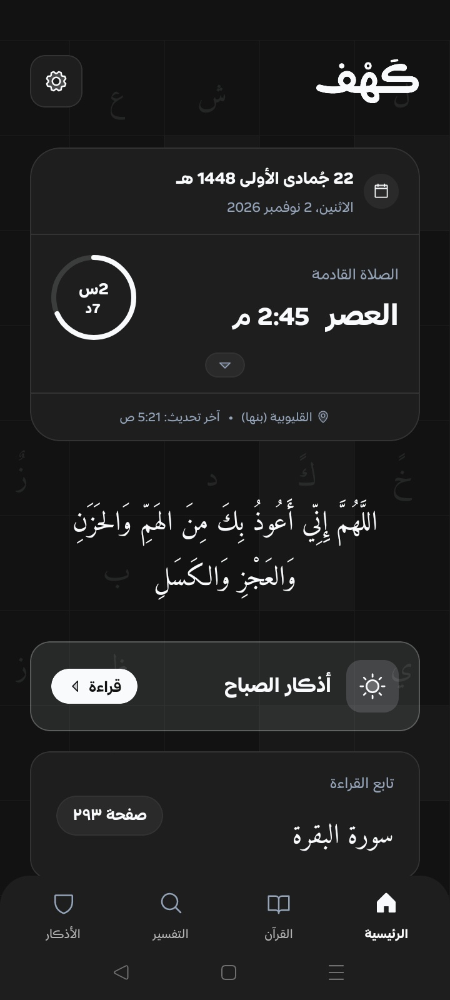
  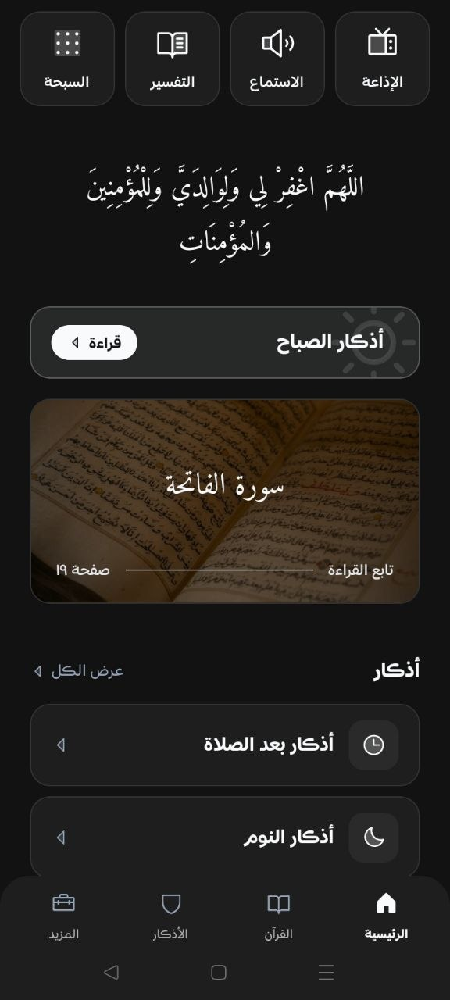
  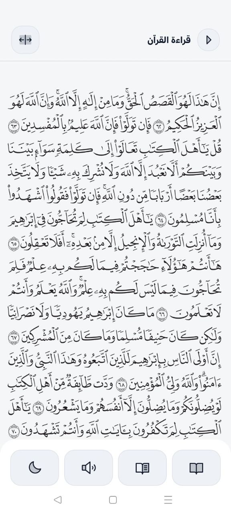
  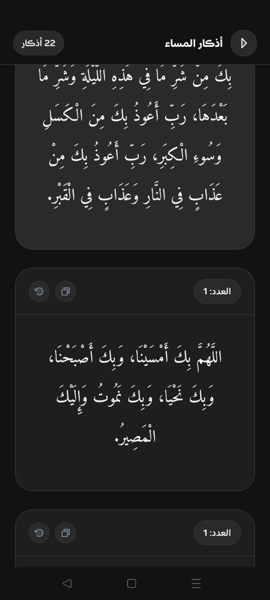
  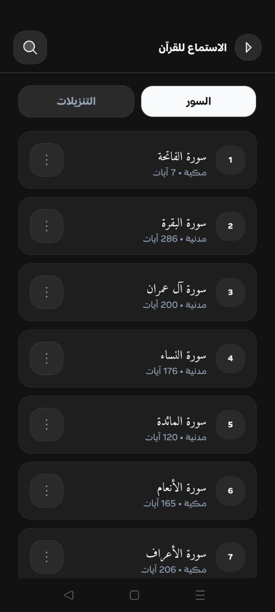
  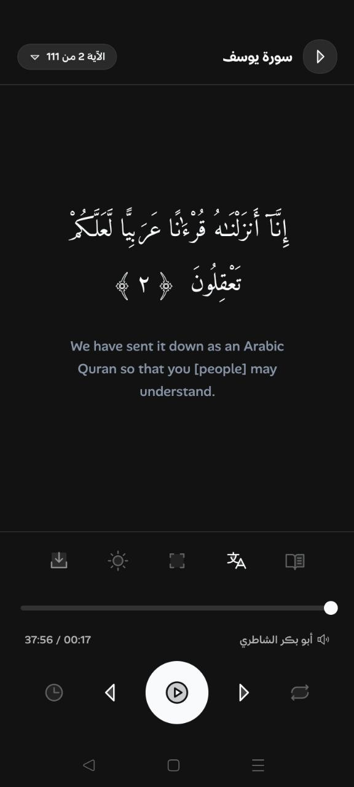
  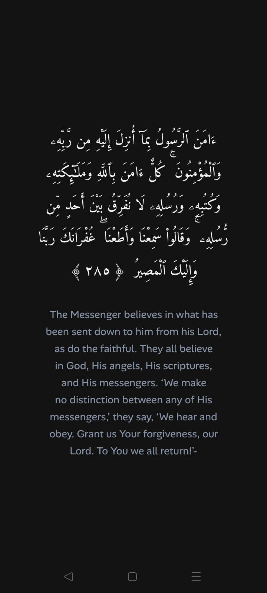
  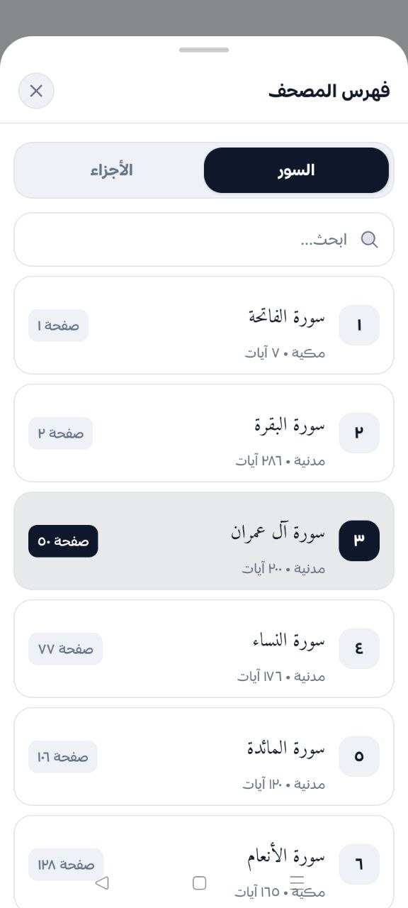
  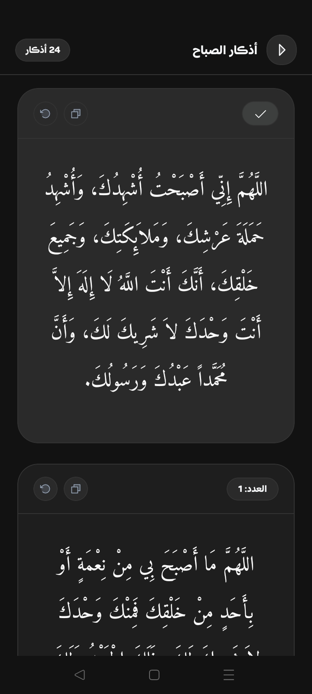

 

## المميزات

- قراءة القرآن الكريم بشكل مريح وسلس مع واجهة نظيفة ومنظمة.
- الاستماع إلى القرآن الكريم بأصوات نخبة من القراء، مع ميزات متقدمة تشمل:
  - آيات متزامنة مع الصوت أثناء القراءة
  - مؤقت النوم
  - سهولة التنقل السريع بين الآيات
  - استكمال التشغيل في الخلفية
  - ترجمة موثوقة للآيات بعدة لغات عالمية
  - وضع التركيز لتجربة استماع خالية من المشتتات
- حساب مواقيت الصلاة بدقة بناءً على موقعك الجغرافي، مع عرض الصلاة القادمة ومؤقت تنازلي.
- **صفحة التفسير:** محرك بحث متقدم يتيح الوصول السريع للآيات والكلمات واستعراض تفاسيرها المعتمدة من كبار الأئمة والعلماء.
- **صفحة الأذكار:** تضم جميع أذكار كتاب "حصن المسلم" منظمة بشكل مريح ومرن مع سهولة التتبع والنسخ.
- كارت تنبيه لأذكار الصباح والمساء في الرئيسية.
- إعدادات شاملة تتيح لك تخصيص التطبيق والميزات بما يناسب تفضيلاتك الشخصية.

 

  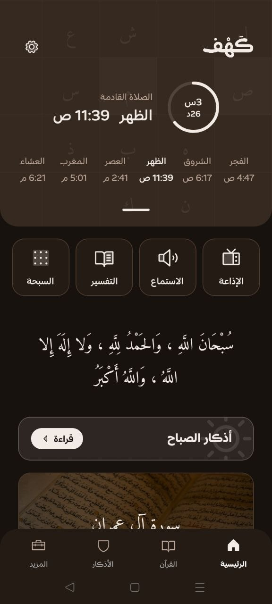
  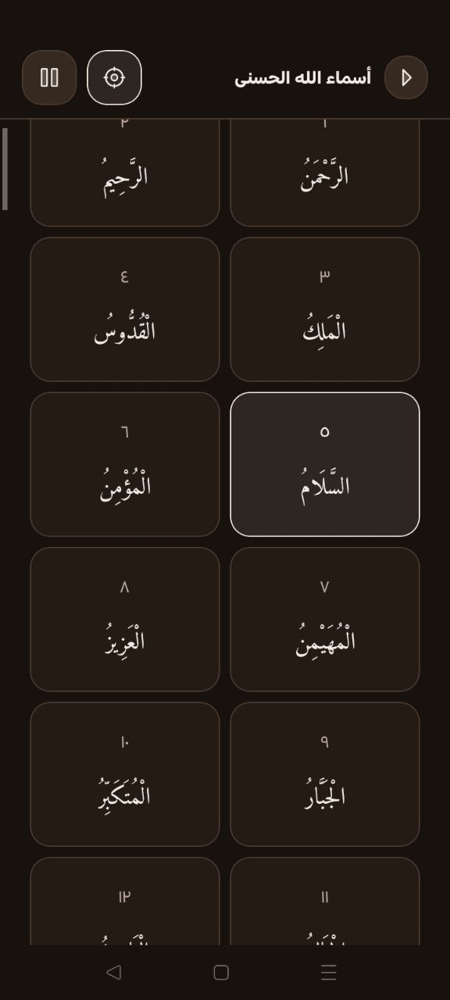
  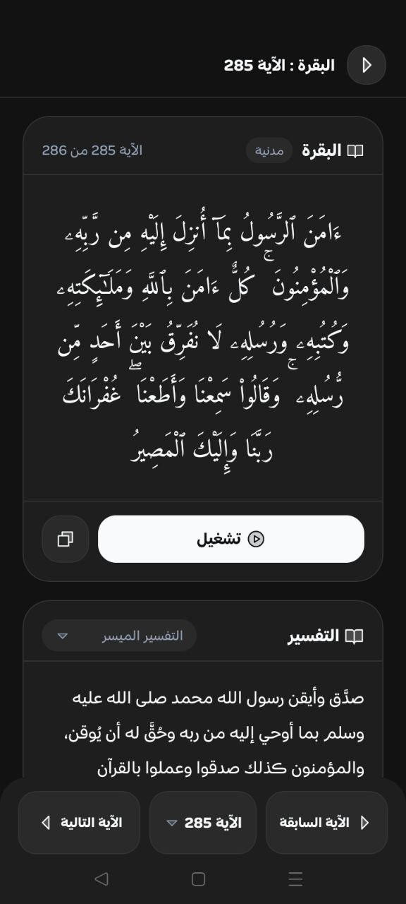
  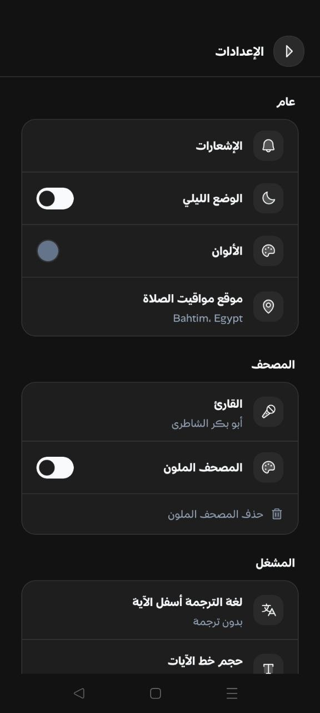
  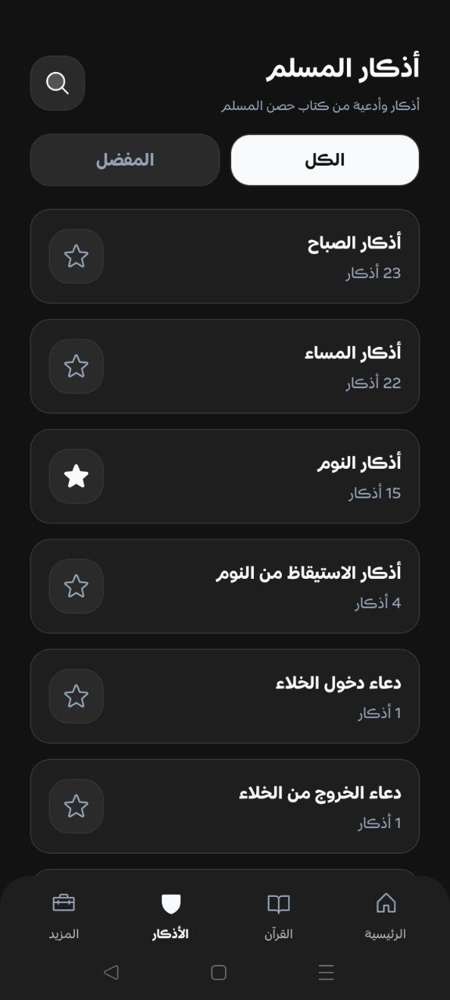
  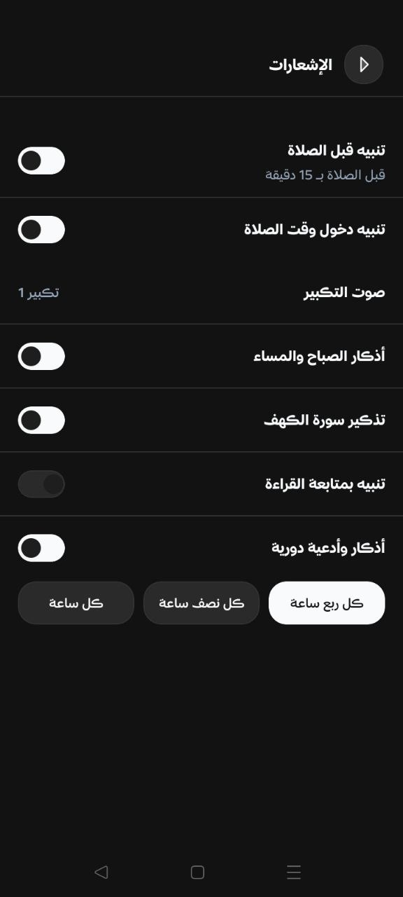
  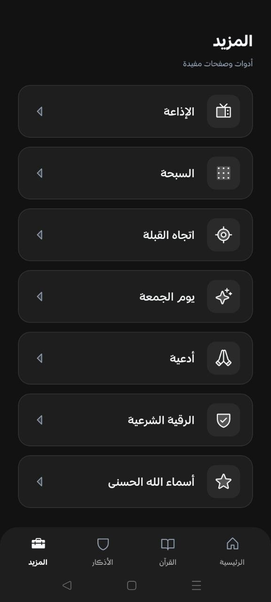
  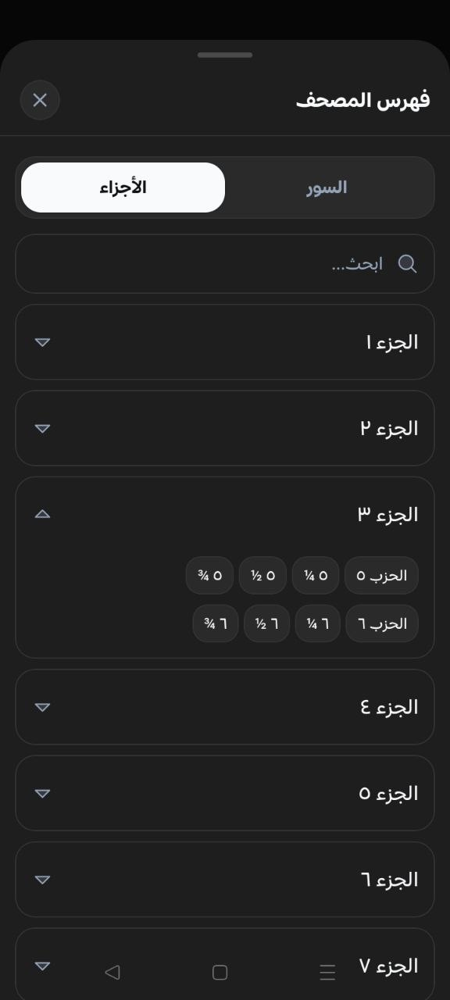
  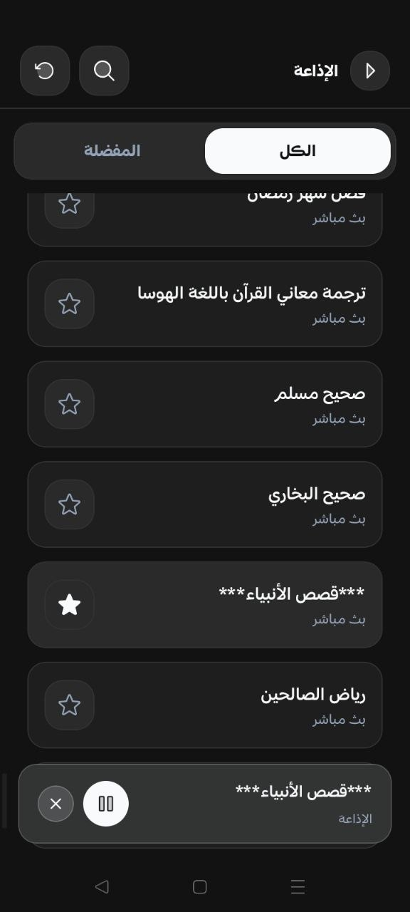

 

 

## التحميل

يمكنك تحميل أحدث إصدار من التطبيق عبر صفحة [الإصدارات (Releases)](https://github.com/you0ssef/Kahf/releases)

> [!TIP]
> إذا لم تكن متأكداً من الإصدار المتوافق مع جهازك، يُرجى تحميل إصدار **Universal** بصيغة APK، فهو يعمل على جميع الأجهزة المدعومة

 

## الترخيص

تطبيق مجاني للاستخدام. جميع الحقوق محفوظة ©
